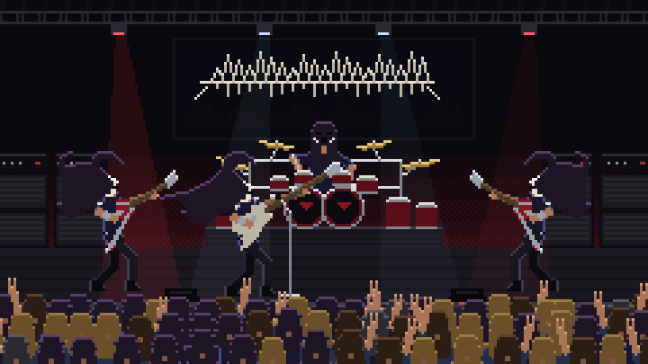

# Headbanger



A pixel-art black metal theme for Claude Code. A corpse-painted band plays on
stage behind your conversation: they headbang while Claude works and wander
the stage between turns, in front of a crowd that grows as your context window
fills up.

The stage shows in the Claude desktop and mobile apps. In the terminal, the
theme changes nothing.

## Install

At the prompt of a Claude Code session:

```
/plugin install headbanger --marketplace david-hosier/claude-headbanger-theme
```

Answer `y` to add the marketplace, then pick where to install it (for you, or
for the project you're in).

Or from a shell:

```
claude plugin install headbanger --marketplace david-hosier/claude-headbanger-theme
```

## What it does

- **Colors.** A dark palette: charcoal surfaces, bone-white text, a frost-blue
  accent and blood red for errors.
- **While Claude works**, the band headbangs in time. Their hair whips back,
  flips over and falls across their faces on each slam. The drummer blasts,
  and the crowd headbangs and throws horns.
- **Between turns**, the guitarists and singer stroll the stage, their hair
  swaying, while the crowd waits.
- **The crowd grows with your context window.** A session starts with a
  handful of fans at the barrier. As the context window fills, more arrive and
  fill the floor; past 75% it's packed. A compaction thins the crowd again.

| Context used | Crowd |
| --- | --- |
| under 15% | a handful of fans at the barrier |
| 15–35% | a small crowd |
| 35–55% | a growing crowd |
| 55–75% | a big crowd |
| 75% and up | packed |

If you've asked your system for reduced motion, the stage is drawn still.

The theme makes no sound.

## How it's drawn

Everything sits on one 240×135 pixel grid. Nothing is rotated or scaled
while drawing: each character is posed and turned into whole pixels frame by
frame. The frames are laid side by side in a strip and played with a CSS
`steps()` animation, like a sprite sheet. The hair is a small physics
simulation (a verlet chain) run through each headbang, so it moves with real
follow-through. Each strip is defined once and reused, which keeps every
scene under the 131,072-character limit for a theme's backdrop.

## Developing

Run a session with the mod loaded from this folder:

```
claude --plugin-dir /path/to/claude-headbanger-theme
```

Check and test it:

```
claude plugin validate .
claude plugin test .
```

| File | What it holds |
| --- | --- |
| `hooks/register.tsx` | The hooks: sets the theme, tracks whether Claude is working and how full the context window is, and draws the backdrop |
| `hooks/scene.ts` | The stage, band, kit, lights and crowd, built as an SVG |
| `hooks/make-colors.js` | Builds the full color theme from a handful of anchor colors |
| `hooks/headbanger.test.tsx` | Tests |
| `types/index.d.ts` | The mod's state: `playing` and `crowd` |

## License

[MIT](LICENSE)
